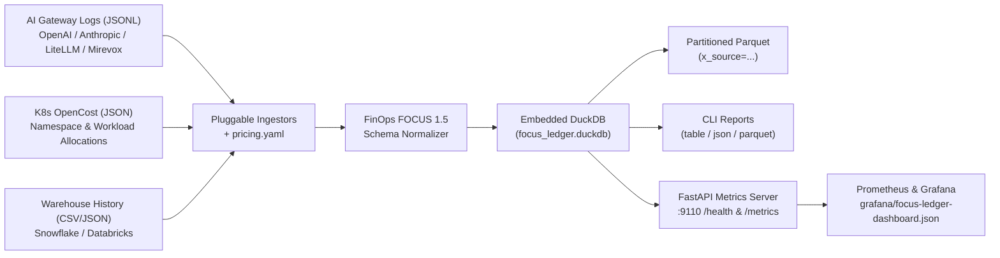

# Focus Ledger

**Unified FinOps & AI Cost Attribution Engine** that normalizes AI gateway token telemetry, Kubernetes OpenCost allocations, and cloud data warehouse query history into the **FinOps FOCUS 1.5** open billing schema—backed by embedded DuckDB and Hive-partitioned Parquet with zero external database dependencies.

---

## Problem Statement

Modern engineering teams run workloads across fragmented cost planes: LLM gateways (OpenAI, Anthropic, LiteLLM, Mirevox Smart Router), Kubernetes clusters, and cloud data warehouses (Snowflake, Databricks). Each emits incompatible schemas, making unified cost attribution by **team**, **project**, **AI model**, or **caller/agent** painful and bespoke.

`focus-ledger` provides a single, lightweight OSS engine that ingests telemetry from all three planes into a canonical **FOCUS 1.5** dataset with native AI attribution columns (`x_model`, `x_caller`, `x_agent_id`, `x_input_tokens`, `x_output_tokens`, `x_cached_tokens`) and exposes Prometheus metrics + Grafana dashboards out of the box.

## Architecture



## Quickstart

### 1. Install Locally

```bash
pip install -e ".[dev]"
```

### 2. Ingest Sample Telemetry

```bash
focus-ledger ingest --source ai-gateway --input examples/ai_gateway_sample.jsonl --db ./data/ledger.duckdb
focus-ledger ingest --source k8s-opencost --input examples/k8s_opencost_sample.json --db ./data/ledger.duckdb
focus-ledger ingest --source warehouse --input examples/warehouse_sample.csv --db ./data/ledger.duckdb
```

### 3. Generate Cost Reports

```bash
focus-ledger report --db ./data/ledger.duckdb --group-by team --format table
focus-ledger report --db ./data/ledger.duckdb --group-by model --format json
focus-ledger report --db ./data/ledger.duckdb --group-by project --format parquet --out ./data/project_costs.parquet
```

### 4. Serve Prometheus Metrics

```bash
focus-ledger serve --port 9110 --db ./data/ledger.duckdb
# Check endpoints:
curl -s http://127.0.0.1:9110/health
curl -s http://127.0.0.1:9110/metrics | head -n 30
```

## CLI Reference

| Command | Flags | Description |
| :--- | :--- | :--- |
| `focus-ledger ingest` | `--source [ai-gateway\|k8s-opencost\|warehouse]`, `--input <file>`, `--db <path>`, `--pricing <yaml>` | Parse raw telemetry into FOCUS 1.5 DuckDB & partitioned Parquet. |
| `focus-ledger report` | `--db <path>`, `--group-by [team\|project\|model\|service]`, `--format [table\|json\|parquet]`, `--out <path>` | Aggregate effective/list cost and token usage across dimensions. |
| `focus-ledger serve` | `--port 9110`, `--host 0.0.0.0`, `--db <path>` | Start FastAPI server exposing `/health` and `/metrics` for Prometheus. |

## Docker Usage

```bash
# Start service
docker compose up --build -d

# Ingest sample datasets inside the container
docker compose exec focus-ledger focus-ledger ingest --source ai-gateway --input examples/ai_gateway_sample.jsonl --db /data/focus_ledger.duckdb
docker compose exec focus-ledger focus-ledger ingest --source k8s-opencost --input examples/k8s_opencost_sample.json --db /data/focus_ledger.duckdb
docker compose exec focus-ledger focus-ledger ingest --source warehouse --input examples/warehouse_sample.csv --db /data/focus_ledger.duckdb

# Verify health and Prometheus metrics
curl -s http://127.0.0.1:9110/health
curl -s http://127.0.0.1:9110/metrics
```

Import `grafana/focus-ledger-dashboard.json` into Grafana pointing at your Prometheus datasource scraping port `9110`.

## Running Tests

```bash
pytest -v
```

## License

Apache License 2.0 — see [LICENSE](LICENSE).
